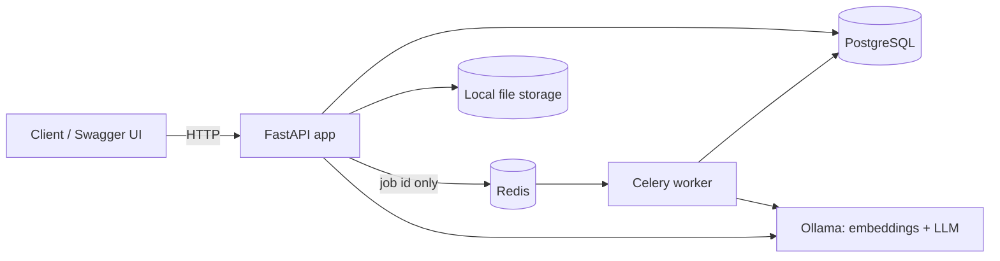
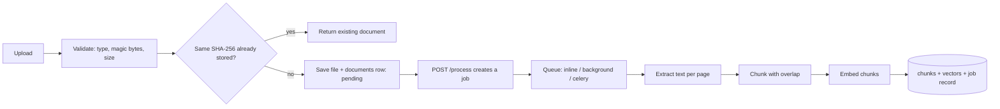
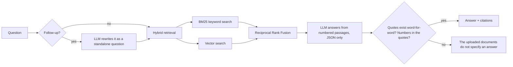

# AI-Powered Vault Document System

"ChatGPT for your documents": upload PDF or DOCX files, get AI insights, and chat with them in plain language.
Every answer comes with citations (document, page, exact quote), and every quote is **checked against the source text** before it is shown.

Built for the Outmarket.ai case study. FastAPI + PostgreSQL + Celery/Redis, with a local LLM (Ollama).

> **Honest status:** everything below works and is tested **except** the real company LLM provider (`AI_MODE=real`),
> which is not implemented yet because no API key has been provided. The system currently runs on local Ollama models.
> See [What is and is not done](#what-is-and-is-not-done).

---

## What it does

| Area | Features |
|---|---|
| Upload | PDF and DOCX only. Extension allow-list, magic-byte check, size limit, safe generated filenames, SHA-256 duplicate detection |
| Processing | Text extraction, page-aware chunking with overlap, embeddings, retry-safe state machine (`pending → processing → completed / failed`) |
| Async | Job queue with three modes: `inline`, `background` (no Redis), `celery` (Redis + worker). `202 Accepted` + `GET /jobs/{id}` |
| Chat | Chat sessions, multi-turn history, follow-up questions ("What about the vehicle policy?"), multi-document questions and comparisons |
| Answers | Hybrid retrieval (BM25 + vectors), citations with page numbers, verified quotes, honest "not specified" refusals |
| Insights | Summary, key points, category, tags. Customisable length, focus and tone |
| Metrics | Document statistics, processing metrics (success rate, p95 duration, failure reasons, stuck documents), answer metrics (refusals, latency) |

---

## Architecture



**Ingestion**



**Answering a question**



### Data model (PostgreSQL)

| Table | Purpose |
|---|---|
| `documents` | Metadata and status (`pending`, `processing`, `completed`, `failed`), SHA-256, page count, safe error message |
| `document_chunks` | Chunk text, page number, embedding (JSON) and the **name of the model that made it** |
| `processing_jobs` | One row per processing run: status, duration, chunk count, failure reason |
| `document_insights` | Summary, key points, category, tags, options used, which generator produced them |
| `chat_sessions` | A conversation, optionally limited to some documents |
| `chat_messages` | Each turn with citations, `answered` flag, generator and latency |

---

## API overview

Interactive docs: `http://127.0.0.1:8000/docs`

| Method and path | Purpose |
|---|---|
| `POST /documents/upload` | Upload PDF/DOCX. `201` new, `200` if the same bytes were uploaded before |
| `GET /documents`, `GET /documents/{id}`, `GET /documents/{id}/status` | List (filter by status, paginate), detail, status |
| `POST /documents/{id}/process` | Process or retry. `200` in `inline` mode, `202` + `job_id` in `background` / `celery` mode |
| `GET /documents/{id}/chunks`, `GET /documents/{id}/jobs` | Inspect chunks and processing history |
| `GET /jobs/{job_id}` | Job status: `queued → running → succeeded / failed` |
| `POST /documents/{id}/insights`, `GET /documents/{id}/insights` | Generate / read summary, key points, category, tags |
| `POST /search` | Retrieval only. Shows exactly which passages an answer would use |
| `POST /ask` | One-off question with citations |
| `POST /chats`, `GET /chats` | Start / list chat sessions |
| `POST /chats/{id}/messages` | Ask inside a conversation (multi-turn) |
| `GET /chats/{id}/history` | Full history with citations |
| `GET /metrics/documents`, `/metrics/processing`, `/metrics/system` | Monitoring data |
| `GET /health` | Liveness and current `ai_mode` |

Error behaviour: `404` unknown id, `409` not processed yet / job already running, `413` too large, `415` wrong type,
`422` bad input, `503` Ollama or the task queue is unreachable (with a message that says what to start).

---

## Setup (Windows, PowerShell)

Requirements: Python 3.10+, PostgreSQL 17, [Ollama](https://ollama.com). Redis only if you want the Celery queue.

```powershell
# 1. Environment
python -m venv .venv
.venv\Scripts\Activate.ps1
pip install -r requirements.txt

# 2. Database (psql as postgres)
#    CREATE USER vault WITH PASSWORD 'choose-a-password';
#    CREATE DATABASE vault OWNER vault;

# 3. Configuration
copy .env.example .env        # then edit DATABASE_URL (real password) and AI_MODE
python -m app.init_db         # creates tables

# 4. Local models (for AI_MODE=ollama)
ollama pull llama3.1
ollama pull nomic-embed-text
python -m app.check_ollama    # PASS/FAIL smoke test of Ollama, embeddings and chat

# 5. Run
uvicorn app.main:app
```

Then open `http://127.0.0.1:8000/docs`. Fictional sample documents are in `data/policies/`.

If you switch `AI_MODE` from `mock` to `ollama` after uploading documents, run `python -m app.reprocess_all` once so existing documents get embeddings.

### Configuration (`.env`)

| Variable | Values | Meaning |
|---|---|---|
| `AI_MODE` | `mock` / `ollama` / `real` | `mock`: keyword search, no AI. `ollama`: local models. `real`: company API (**not implemented yet**) |
| `TASK_BACKEND` | `inline` / `background` / `celery` | How `/process` runs. See below |
| `AUTO_INSIGHTS` | `true` / `false` | Queued processing also generates insights |
| `REDIS_URL` | URL | Only for `celery` |
| `OLLAMA_CHAT_MODEL`, `OLLAMA_EMBED_MODEL` | model names | Defaults `llama3.1:latest`, `nomic-embed-text` |
| `MAX_UPLOAD_MB` | number | Upload size limit |

`.env` is git-ignored. Never commit it.

### Running the real queue (Celery + Redis)

```powershell
docker run -d --name vault-redis -p 6379:6379 redis:7     # or Memurai on Windows (Redis-compatible, no Docker/WSL needed)
# set TASK_BACKEND=celery in .env
celery -A app.worker worker --pool=solo --loglevel=info   # second terminal; --pool=solo is required on Windows
uvicorn app.main:app
```

Only job ids travel through Redis. Status, timings and errors live in PostgreSQL, so losing the queue never loses history.

---

### Frontend (Next.js)

A small Next.js app in `frontend/` (plain JavaScript, no UI library) talks to the API. Pages: **Documents** (upload, process, retry, job polling), **Chat** (multi-turn, verified citations, refusals shown clearly), **Insights** (summary, key points, category, tags with length/tone/focus), **Metrics** (document, processing and answer metrics).

```powershell
cd frontend
npm install
copy .env.example .env.local     # optional, defaults to http://127.0.0.1:8000
npm run dev                      # http://localhost:3000
```

The backend must be running; its `CORS_ORIGINS` setting (default `http://localhost:3000`) lets the browser call it. The frontend has no automated tests; it was checked by building it and clicking through every page.

## Testing

```powershell
pytest
```

At the last full run: **133 passed, 1 expected failure (xfail)**.

- No test calls a real model or the network. Ollama is replaced by scripted fakes (`httpx.MockTransport`), so the suite is fast and deterministic.
- The `.env` file can never leak into tests: the test client forces `ai_mode="mock"`.
- Several safety guards were checked by deliberately breaking them and confirming a test fails.
- The one `xfail` documents a known limitation: **keyword-only search cannot match synonyms** ("cosmetic surgery" vs "cosmetic procedures"). Hybrid mode with embeddings solves it; this is shown by a separate passing test.
- What the tests do **not** prove: how a real LLM behaves. Real-model behaviour was checked by hand through Swagger (see `DEMO.md`).
- The Celery worker is unit-tested with fakes (no Redis needed). The live path was verified **by hand** on Windows with Memurai (a Redis-compatible server): `POST /process` returned 202, the worker received and finished the task, and `GET /jobs/{id}` showed `succeeded`. It is not part of the automated suite.

---

## Design decisions and assumptions

**Hand-built RAG instead of LangChain / LlamaIndex.** This was my first RAG project. My goal was not only to finish on time but to understand how
RAG works internally: extraction, chunking, embeddings, hybrid retrieval and answer generation. I built each part with plain Python libraries and custom logic, working with an AI assistant (see `AI_USAGE.md`) and running and checking every step myself. That gave me
control over retrieval and citation verification, and a strong foundation for using a framework well later. The trade-off is real: a framework
reduces development and maintenance effort and brings ready-made integrations. The code uses small interfaces (`Retriever`, `Embedder`, `LLMProvider`,
`InsightGenerator`), so a LangChain or LlamaIndex retriever could be plugged in without changing the API.

**Trust nothing the model says.** The LLM must return JSON with exact quotes. A quote is kept only if it appears word for word in the retrieved passage, and every number in the answer must appear in a kept quote.
Otherwise the answer becomes "The uploaded documents do not specify an answer to this question." Document text is placed inside `<context>` tags and the prompt treats it as untrusted data (prompt-injection defence).
Known gap: a verified quote proves the text exists, not that it answers the right question. We saw this once (a vehicle-policy follow-up answered from the health policy) and fixed the cause with question rewriting, but the check itself cannot detect it.

**Hybrid retrieval.** BM25 finds exact terms (numbers, names, codes). Embeddings find meaning ("cosmetic surgery" ↔ "cosmetic procedures"). Scores are merged with Reciprocal Rank Fusion, which uses ranks only, because BM25 scores and cosine similarities are on different scales.

**Embeddings carry the model name.** Vectors from different models are not comparable, so retrieval only compares vectors from the same model. Switching models is safe: re-run `reprocess_all`.

**Embedding failure is not fatal.** If Ollama is down during processing, the document still becomes `completed` (keyword search works) with a visible warning. Re-running `/process` retries the embeddings.

**Follow-up questions.** With a real LLM, a follow-up is rewritten into a standalone question and that is used for search and answering. If the rewrite fails or is unusable, a keyword heuristic adds the previous question. Only the last 3 turns are sent to the model.

**Processing is safe to repeat.** Old chunks are deleted before new ones are written, finished jobs are skipped when a queue re-delivers them, and a job stuck for 15 minutes no longer blocks a new one.

**User-safe errors.** Messages shown to users never contain server paths or stack traces. Full detail goes to the server log.

**Prompts** live in `app/providers.py` (answering), `app/conversation.py` (question rewriting) and `app/insights.py` (insights). Each has rules for grounding, refusal, untrusted input and strict output shape.

### Thinking about scale (thousands of documents)

- Processing is already off the request path; add more Celery workers to go faster.
- Vector search currently compares vectors in Python. Next step: **pgvector** with an index. Keyword search: PostgreSQL full-text search.
- Cache query embeddings and frequent answers in Redis. Embeddings are already stored once per chunk, never recomputed per question.
- Add per-user rate limits and quotas before exposing a paid LLM API. Track tokens and cost per request.
- Replace the small `ALTER TABLE` step in `init_db` with Alembic migrations.

---

## What is and is not done

**Done and tested:** upload, processing, chunking, embeddings, hybrid retrieval, cited and verified answers, chat sessions with history and follow-ups, insights, metrics APIs, job tracking, async queue (three modes), health endpoint, 133 tests.

**Not done / limitations (honest list):**
- **Real LLM provider (OpenAI / Claude): not implemented.** `AI_MODE=real` returns a clear configuration error. Waiting for a company API key.
- **Frontend is minimal and untested by code.** It works against the real API but has no automated tests, no auth, and no streaming.
- **No authentication or per-user data separation.** Everything is one shared vault.
- **No streaming responses**, no WebSockets.
- **Scanned PDFs (no text layer):** rejected with a clear message. OCR is not supported.
- **Embeddings stored as JSON**, searched in Python. Fine for a demo, not for large scale.
- **Follow-ups** are one level deep: a follow-up to a follow-up loses the first question in heuristic mode.
- **Mock mode** (`AI_MODE=mock`) is keyword-only and handles follow-ups and synonyms poorly. It exists so the app and tests run without any AI.
- **Cost tracking and rate limiting** are not implemented.
- **Celery + Redis** was verified by hand on one machine (Windows, Memurai, `--pool=solo`), not in CI. On Windows a single solo worker adds a few seconds of pickup latency; on Linux use the default pool.

See `REQUIREMENTS_CHECKLIST.md` for every requirement in the case study mapped to its status, `AI_USAGE.md` for how AI tools were used, and `DEMO.md` for a demo script.
