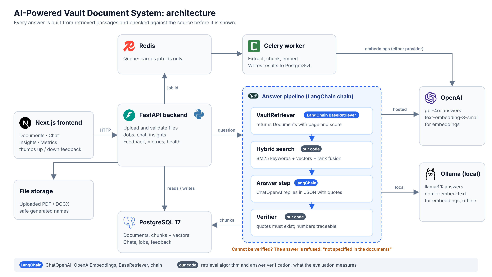
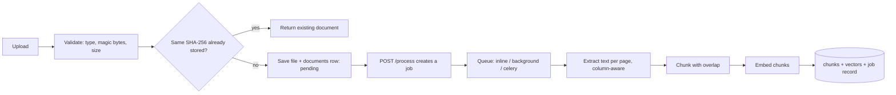
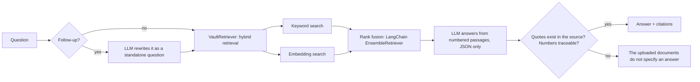
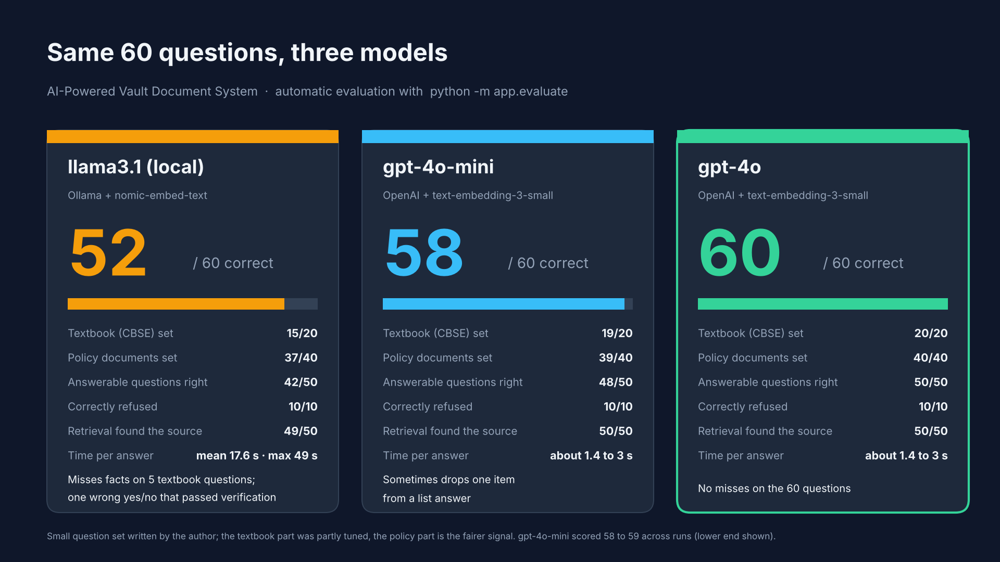
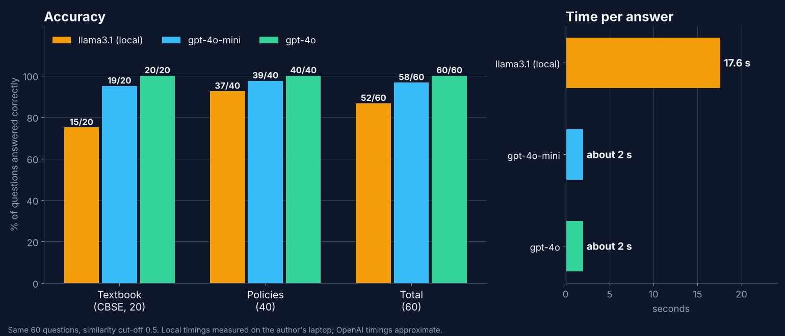

# AI-Powered Vault Document System

"ChatGPT for your documents": upload PDF or DOCX files, get AI insights, and chat with them in plain language.
Every answer comes with citations (document, page, exact quote), and every quote is **checked against the source text** before it is shown.

Built for the Outmarket.ai case study. FastAPI + PostgreSQL + Celery/Redis + Next.js, with LangChain wiring a hosted model (OpenAI) or local models (Ollama).

> **Status:** everything below works and is tested. The hosted-model path (OpenAI through LangChain) was run end to end with a
> company key and measured with a 60-question evaluation ([Evaluation](#evaluation)); the unit tests use fakes and never call a model.
> Local Ollama models remain a supported option. See [What is and is not done](#what-is-and-is-not-done).

---

## What it does

| Area | Features |
|---|---|
| Upload | PDF and DOCX only. Extension allow-list, magic-byte check, size limit, safe generated filenames, SHA-256 duplicate detection |
| Processing | Column-aware text extraction, page-aware chunking with overlap, embeddings, retry-safe state machine (`pending → processing → completed / failed`) |
| Async | Job queue with three modes: `inline`, `background` (no Redis), `celery` (Redis + worker). `202 Accepted` + `GET /jobs/{id}` |
| Chat | Chat sessions, multi-turn history, follow-up questions ("What about the vehicle policy?"), multi-document questions and comparisons |
| Answers | Hybrid retrieval (keywords + embeddings), citations with page numbers, verified quotes, honest "not specified" refusals |
| Insights | Summary, key points, category, tags. Customisable length, focus and tone |
| Feedback | Thumbs up / down on every answer and on every document summary, with an optional comment on a thumbs down |
| Metrics | Document statistics, processing metrics (success rate, p95 duration, failure reasons, stuck documents), answer metrics (refusals, latency), user satisfaction |
| Evaluation | `python -m app.evaluate`: 60 questions with expected facts, source and refusals, scored automatically |

---

## Architecture



LangChain provides the model calls (`ChatOpenAI`, `OpenAIEmbeddings`), the search (`BM25Retriever`, a vector store and `EnsembleRetriever`, exposed as a `BaseRetriever`) and the chain that runs the answer steps.
The answer verification, and the word splitting that feeds keyword search, are our own code because they are specific to this problem. Source of the diagram: `docs/architecture.svg`.

**Ingestion**



**Answering a question**



### Data model (PostgreSQL)

| Table | Purpose |
|---|---|
| `documents` | Metadata and status (`pending`, `processing`, `completed`, `failed`), SHA-256, page count, safe error message |
| `document_chunks` | Chunk text, page number, embedding (JSON) and the **name of the model that made it** |
| `processing_jobs` | One row per processing run: status, duration, chunk count, failure reason |
| `document_insights` | Summary, key points, category, tags, options used, which generator produced them |
| `chat_sessions` | A conversation, optionally limited to some documents |
| `chat_messages` | Each turn with citations, `answered` flag, generator and latency |
| `message_feedback` | One thumbs up / down (and optional comment) per assistant answer |
| `insight_feedback` | One thumbs up / down per document summary; cleared when the summary is regenerated |

---

## API overview

Interactive docs: `http://127.0.0.1:8000/docs`

| Method and path | Purpose |
|---|---|
| `POST /documents/upload` | Upload PDF/DOCX. `201` new, `200` if the same bytes were uploaded before |
| `GET /documents`, `GET /documents/{id}`, `GET /documents/{id}/status` | List (filter by status, paginate), detail, status |
| `POST /documents/{id}/process` | Process or retry. `200` in `inline` mode, `202` + `job_id` in `background` / `celery` mode |
| `GET /documents/{id}/chunks`, `GET /documents/{id}/jobs` | Inspect chunks and processing history |
| `GET /jobs/{job_id}` | Job status: `queued → running → succeeded / failed` |
| `POST /documents/{id}/insights`, `GET /documents/{id}/insights` | Generate / read summary, key points, category, tags |
| `PUT` / `DELETE /documents/{id}/insights/feedback` | Thumbs up / down on the summary, or take it back |
| `POST /search` | Retrieval only. Shows exactly which passages an answer would use |
| `POST /ask` | One-off question with citations |
| `POST /chats`, `GET /chats` | Start / list chat sessions |
| `POST /chats/{id}/messages` | Ask inside a conversation (multi-turn) |
| `PUT` / `DELETE /chats/{id}/messages/{message_id}/feedback` | Thumbs up / down on an answer, or take it back |
| `GET /chats/{id}/history` | Full history with citations and ratings |
| `GET /metrics/documents`, `/metrics/processing`, `/metrics/system`, `/metrics/feedback` | Monitoring data, including satisfaction rate and the latest thumbs down |
| `GET /health` | Liveness and current `ai_mode` |

Error behaviour: `404` unknown id, `409` not processed yet / job already running, `413` too large, `415` wrong type,
`422` bad input, `503` the AI service or the task queue is unreachable (with a message that says what to start).

---

## Setup (Windows, PowerShell)

Requirements: Python 3.10+, PostgreSQL 17. Redis only for the Celery queue. [Ollama](https://ollama.com) only for local models. An OpenAI key only for the hosted option.

```powershell
# 1. Environment
python -m venv .venv
.venv\Scripts\Activate.ps1
pip install -r requirements.txt

# 2. Database (psql as postgres)
#    CREATE USER vault WITH PASSWORD 'choose-a-password';
#    CREATE DATABASE vault OWNER vault;

# 3. Configuration
copy .env.example .env        # then edit DATABASE_URL (real password) and the AI settings below
python -m app.init_db         # creates tables

# 4. Run
uvicorn app.main:app
```

Then open `http://127.0.0.1:8000/docs`. Fictional sample documents are in `data/policies/`.

Run the backend commands from the project root (the folder that contains `app/`), not from `frontend/`.

### Choosing the AI (`.env`)

| Goal | Settings | Extra step |
|---|---|---|
| No AI, offline, for tests | `AI_MODE=mock` | none |
| **Hosted (best measured quality)** | `AI_MODE=real`, `CHAT_PROVIDER=openai`, `EMBED_PROVIDER=openai`, `OPENAI_API_KEY=...`, `OPENAI_CHAT_MODEL=gpt-4o` | `python -m app.check_openai`, then `python -m app.reprocess_all` |
| Fully local | `AI_MODE=real`, `CHAT_PROVIDER=ollama`, `EMBED_PROVIDER=ollama` | `ollama pull llama3.1` and `ollama pull nomic-embed-text`, `python -m app.check_ollama`, `python -m app.reprocess_all` |

The API key goes in `.env` only (git-ignored). `check_openai` prints only the last four characters of the key. After changing `EMBED_PROVIDER`, run `reprocess_all` once: vectors from different models cannot be compared, so each chunk stores the name of the model that made it.

### Configuration reference

| Variable | Values | Meaning |
|---|---|---|
| `AI_MODE` | `mock` / `real` (`ollama` is the older name for `real`) | `mock`: keyword search, no AI. `real`: embeddings + LLM from the providers below |
| `CHAT_PROVIDER` | `ollama` / `openai` | Which model writes the answers |
| `EMBED_PROVIDER` | `ollama` / `openai` | Which model makes the vectors. Re-run `reprocess_all` after changing |
| `OPENAI_API_KEY`, `OPENAI_CHAT_MODEL`, `OPENAI_EMBED_MODEL` | | Defaults `gpt-4o-mini` and `text-embedding-3-small`; `gpt-4o` scored best |
| `OPENAI_BASE_URL`, `OPENAI_TEMPERATURE` | optional | Company gateway; temperature (default `0`, blank = do not send) |
| `OLLAMA_CHAT_MODEL`, `OLLAMA_EMBED_MODEL` | model names | Defaults `llama3.1:latest`, `nomic-embed-text` |
| `VECTOR_MIN_SIMILARITY` | number | Cosine cut-off, default `0.5`. Measured: `0.3` was worse than `0.5` with OpenAI embeddings |
| `RETRIEVER` | `langchain` (default) / `own` | LangChain's `EnsembleRetriever` (keyword + embedding search), or the earlier hand-written version. Both scored 60/60 |
| `PIPELINE` | `langchain` (default) / `own` | The answer flow as a LangChain chain, or as a plain function. Same results |
| `CHUNKER` | `own` (default) / `langchain` | Sliding window, or LangChain's sentence-aware splitter. See Evaluation |
| `TASK_BACKEND` | `inline` / `background` / `celery` | How `/process` runs. See below |
| `AUTO_INSIGHTS` | `true` / `false` | Queued processing also generates insights |
| `REDIS_URL` | URL | Only for `celery` |
| `MAX_UPLOAD_MB` | number | Upload size limit |

`.env` is git-ignored. Never commit it.

### Running the real queue (Celery + Redis)

```powershell
docker run -d --name vault-redis -p 6379:6379 redis:7     # or Memurai on Windows (Redis-compatible, no Docker/WSL needed)
# set TASK_BACKEND=celery in .env
celery -A app.worker worker --pool=solo --loglevel=info   # second terminal; --pool=solo is required on Windows
uvicorn app.main:app
```

Only job ids travel through Redis. Status, timings and errors live in PostgreSQL, so losing the queue never loses history.
Restart the worker after changing `.env` or code: it keeps the settings it started with.

---

### Frontend (Next.js)

A small Next.js app in `frontend/` (plain JavaScript, no UI library) talks to the API. Pages: **Documents** (upload, process, retry, job polling), **Chat** (multi-turn, verified citations, refusals shown clearly, thumbs up / down), **Insights** (summary, key points, category, tags with length/tone/focus, thumbs up / down), **Metrics** (document, processing, answer and feedback metrics).

```powershell
cd frontend
npm install
copy .env.example .env.local     # optional, defaults to http://127.0.0.1:8000
npm run dev                      # http://localhost:3000
```

The backend must be running; its `CORS_ORIGINS` setting (default `http://localhost:3000`) lets the browser call it. The frontend has no automated tests; it was checked by building it and clicking through the pages.

## Testing

```powershell
pytest
```

At the last full run: **210 passed, 1 expected failure (xfail)**.

- No test calls a real model or the network. Models are replaced by scripted fakes, so the suite is fast and deterministic.
- The `.env` file can never leak into tests: the test client forces `ai_mode="mock"`.
- Several safety guards were checked by deliberately breaking them and confirming a test fails.
- The one `xfail` documents a known limitation: **keyword-only search cannot match synonyms** ("cosmetic surgery" vs "cosmetic procedures"). Hybrid mode with embeddings solves it; this is shown by a separate passing test.
- What the tests do **not** prove: how a real LLM behaves. That is what the evaluation below is for.
- The Celery worker is unit-tested with fakes (no Redis needed). The live path was verified **by hand** on Windows with Memurai (a Redis-compatible server). It is not part of the automated suite.

## Evaluation

```powershell
python -m app.evaluate                          # all 60 questions with the model in .env
python -m app.evaluate --set policies           # or: cbse
python -m app.evaluate --only 8,117 --model gpt-4o
python -m app.evaluate --retrieval-only --retriever langchain    # only checks that search finds the right page; no answer-model calls
```

The set has two parts: **CBSE** (20 questions on a physics textbook chapter, including a misspelt question and 5 that must be refused) and **Policies** (40 questions over the six policy documents, including a misspelt question, cross-document comparisons, a reasoning question and 5 that must be refused).
Each question lists the facts the answer must contain and the page it must come from; the script also checks that retrieval found that page. A full run makes roughly 100 to 150 API calls.

| Setup (OpenAI embeddings, similarity 0.5) | Total | CBSE | Policies | Retrieval found the source |
|---|---|---|---|---|
| gpt-4o, LangChain retriever and chain (the default) | **60/60** | 20/20 | 40/40 | 15/15 and 35/35 |
| gpt-4o, hand-written retriever, LangChain chain | 60/60 | 20/20 | 40/40 | 15/15 and 35/35 |
| gpt-4o, hand-written retriever and plain-function pipeline | 60/60 | 20/20 | 40/40 | 15/15 and 35/35 |
| gpt-4o, LangChain sentence splitter | 59/60 | 19/20 | 40/40 | 15/15 and 35/35 |
| gpt-4o-mini | 58 to 59/60 | 18 to 19/20 | 39 to 40/40 | 15/15 and 35/35 |

### Model comparison





| | llama3.1 (local) | gpt-4o-mini | gpt-4o |
|---|---|---|---|
| Embeddings | nomic-embed-text (Ollama) | text-embedding-3-small | text-embedding-3-small |
| Total | 52/60 | 58 to 59/60 | **60/60** |
| Textbook (CBSE) | 15/20 | 18 to 19/20 | 20/20 |
| Policies | 37/40 | 39 to 40/40 | 40/40 |
| Answerable questions right | 42/50 | 48 to 49/50 | 50/50 |
| Correctly refused | 10/10 | 10/10 | 10/10 |
| Retrieval found the source | 49/50 | 50/50 | 50/50 |
| Time per answer | mean 17.6 s (4 to 49 s) | about 1.4 to 3 s | mean 1.7 s (1.2 to 2.7 s) |

Analysis:
- **Refusing is easy, answering is hard.** All three models refused all 10 unanswerable questions. The gap is entirely on answerable questions, where the local model got 42 of 50.
- **Retrieval is not the problem.** The right page was found for 49 of 50 questions with the local embeddings and 50 of 50 with OpenAI's. The 8 local misses are the model's reading of the passage, not search.
- **What the local model gets wrong:** five textbook questions answered incompletely or without the "why" (for example the sum of 436.32 g, 227.2 g and 0.301 g: it gave the rounded number but not the reason); one question with two valid answers where it gave one; one parental-leave answer rejected by the verifier because the model wrote "according to passage 1" and the "1" is not in the document.
- **One wrong answer passed verification.** Asked "Can I cancel my order after it has been dispatched?", the local model answered "Yes" and quoted a real sentence: "After dispatch, the return process applies." The quote exists but does not support "yes". This is the known gap: verification proves a quote exists, not that it answers the question. gpt-4o answered correctly.
- **Speed.** The local model needed 17.6 s on average on a laptop, against about 2 s hosted, so the hosted model is also about 8 times faster.
- **Takeaway:** the local model is usable for a private, offline setup and the verifier keeps it from inventing text, but the hosted gpt-4o is clearly better. The recommended setting is gpt-4o with OpenAI embeddings.
- **Limits of this comparison:** the three setups differ in both the answering model and the embeddings, so the table does not separate their effects. Mixed setups (local embeddings with gpt-4o, or OpenAI embeddings with llama3.1) were not run. OpenAI timings are approximate; the local timings come from one full run on my laptop.

What these numbers mean, and do not mean:
- It is a small set written by me, not a benchmark. The CBSE questions were used while fixing problems, so that part is partly tuned; the policy questions were not tuned against and are the fairer signal.
- The LangChain pipeline gives the same results as the plain function: the move to LangChain changed the wiring, not the answers.
- The LangChain sentence splitter scored one point lower: with the new chunk boundaries the passage for "which two extra SI units?" fell out of the top results and the model answered "joule and newton". The verifier accepted it because the quotes exist in the document. The splitter stays available (`CHUNKER=langchain`) but is off by default.
- gpt-4o-mini sometimes drops an item from a list (it named two of three formulas in one question). gpt-4o did not.
- The local model (`llama3.1` with `nomic-embed-text`) scored 52/60 with the current code. See the comparison above.

---

## Design decisions and assumptions

**LangChain for the wiring and the search, our own code for what keeps answers honest.** The case study recommends LangChain, and the system uses it for the model calls (`ChatOpenAI`, `OpenAIEmbeddings`), the search (`BM25Retriever`, a vector store and `EnsembleRetriever`, exposed as a `BaseRetriever` that returns `Document` objects) and the chain that runs retrieve, answer and verify.
This was my first RAG project, and out of curiosity about how it works inside, I also built the whole retrieval by hand first (extraction, chunking, search, rank fusion and the answer checks), to learn how it works and to compare it with LangChain. I then rebuilt the search on LangChain's own retrievers and ran the same questions both ways. The hand-written version stays available as `RETRIEVER=own`.
Results: both versions scored 60/60 with gpt-4o. Retrieval alone (50 questions with a source page, local embeddings) found the page 49/50 times for both, and put it first 46/50 times, but LangChain's keyword search with its default word splitting (spaces only, case-sensitive, no stemming) only put it first 38/50 times. So LangChain's search is fed our small word-splitting step, and then matches the hand-written one exactly.
The verifier stays our own code because nothing in LangChain checks that quotes exist in the source.

**Trust nothing the model says.** The LLM must return JSON with quotes. A quote is kept only if it can be found in the retrieved passages (after ignoring spacing, bullets, dash styles and superscripts, and allowing "..." inside a quote and a quote that continues into the next chunk). The text shown to the user is the document's own wording, not the model's copy.
Every number in the answer must be traceable: it appears in a cited passage, on the same page as a cited passage, in the question, or is the difference of two quoted figures ("faster by 1 day" from 2 and 3 days). Anything else becomes "The uploaded documents do not specify an answer to this question." Document text is placed inside `<context>` tags and the prompt treats it as untrusted data (prompt-injection defence).
These rules are looser than my first version. Each was relaxed after the evaluation showed correct answers being refused, and each has a test that also checks the matching wrong case is still rejected.
Known gap: a verified quote proves the text exists, not that it answers the right question. We saw this twice (a vehicle-policy follow-up answered from the health policy, and the SI-units answer above). A relevance check is the next improvement.

**Hybrid retrieval.** Keyword search finds exact terms (numbers, names, codes). Embedding search finds meaning ("cosmetic surgery" ↔ "cosmetic procedures", or a misspelt question). The two rankings are merged by rank fusion (LangChain's `EnsembleRetriever`), which uses ranks only, because keyword scores and similarity scores are on different scales.

**Column-aware extraction.** Two-column PDF pages (the textbook) were read line by line across both columns, which mixed sentences. Extraction now orders text blocks column by column.

**Embeddings carry the model name.** Vectors from different models are not comparable, so retrieval only compares vectors from the same model. Switching models is safe: re-run `reprocess_all`.

**Embedding failure is not fatal.** If the embedding service is down during processing, the document still becomes `completed` (keyword search works) with a visible warning. Re-running `/process` retries the embeddings.

**Follow-up questions.** With a real LLM, a follow-up is rewritten into a standalone question and that is used for search and answering (this step uses the same chat provider as the answers: gpt-4o when `CHAT_PROVIDER=openai`, otherwise the local Ollama model). If the rewrite fails or is unusable, a keyword heuristic adds the previous question. Only the last 3 turns are sent to the model.

**Feedback.** One rating per answer or summary; changing your mind replaces it. A rating belongs to the summary it was given to, so regenerating a summary clears it. The Metrics page shows the satisfaction rate (thumbs up divided by rated answers) next to how many answers were rated at all, so a high rate from two ratings is not mistaken for a high rate from two hundred.

**Processing is safe to repeat.** Old chunks are deleted before new ones are written, finished jobs are skipped when a queue re-delivers them, and a job stuck for 15 minutes no longer blocks a new one.

**Calls to the hosted model are kept deliberate.** Embeddings are computed once per chunk, never per question, and the evaluation can run a chosen subset of questions.

**User-safe errors.** Messages shown to users never contain server paths, stack traces or keys. Errors from the hosted model show the error type and HTTP status only. Full detail goes to the server log.

**Prompts** live in `app/providers.py` (answering), `app/conversation.py` (question rewriting) and `app/insights.py` (insights). Each has rules for grounding, refusal, untrusted input and strict output shape.

### Thinking about scale (thousands of documents)

- Processing is already off the request path; add more Celery workers to go faster.
- Vector search currently compares vectors in Python. Next step: **pgvector** with an index. Keyword search: PostgreSQL full-text search.
- Cache query embeddings and frequent answers in Redis. Embeddings are already stored once per chunk, never recomputed per question.
- Add per-user rate limits and quotas before exposing a paid LLM API. Track tokens and cost per request.
- Replace the small `ALTER TABLE` step in `init_db` with Alembic migrations (new tables are created automatically; changes to existing tables are not).

---

## What is and is not done

**Done and tested:** upload, column-aware processing, chunking, embeddings (OpenAI or local), hybrid retrieval, cited and verified answers, chat sessions with history and follow-ups, insights, thumbs up / down feedback with metrics, metrics APIs, job tracking, async queue (three modes), health endpoint, LangChain pipeline, an evaluation script with 60 questions, 210 tests.

**Not done / limitations (honest list):**
- **Verification checks that a quote exists, not that it is relevant.** A wrong answer can pass if its quotes are real.
- **The local model is weaker.** `llama3.1` is slow on a laptop (4 to 49 seconds per answer, 17.6 on average) and scored 52/60 against 60/60 for the hosted gpt-4o. The hosted model answers in about 2 seconds.
- **The evaluation is small and partly tuned** (see Evaluation). The hosted-model path is verified by the evaluation runs, not by automated tests.
- **Follow-up rewriting and insights follow the chat provider** (gpt-4o with `CHAT_PROVIDER=openai`, Ollama otherwise). If the rewrite fails, follow-ups fall back to the keyword heuristic; if the insights call fails, the API returns an error.
- **Frontend is minimal and untested by code.** It works against the real API but has no automated tests, no auth, and no streaming.
- **No authentication or per-user data separation.** Everything is one shared vault; feedback is not tied to a user.
- **No streaming responses**, no WebSockets.
- **Scanned PDFs (no text layer):** rejected with a clear message. OCR is not supported.
- **Embeddings stored as JSON**, searched in Python. Fine for a demo, not for large scale.
- **Follow-ups** are one level deep: a follow-up to a follow-up loses the first question in heuristic mode.
- **Mock mode** (`AI_MODE=mock`) is keyword-only and handles follow-ups and synonyms poorly. It exists so the app and tests run without any AI.
- **Cost tracking and rate limiting** are not implemented.
- **`BM25Retriever` lives in `langchain-community`, which LangChain has marked as being sunset.** If it is removed, `RETRIEVER=own` keeps working with the hand-written search.
- **A model sometimes glues a number to the next word** (once seen as "3business days"). The meaning is intact; it is cosmetic.
- **Celery + Redis** was verified by hand on one machine (Windows, Memurai, `--pool=solo`), not in CI. On Windows a single solo worker adds a few seconds of pickup latency; on Linux use the default pool.

See `REQUIREMENTS_CHECKLIST.md` for every requirement in the case study mapped to its status, `AI_USAGE.md` for how AI is used in the product and in development, `PROJECT_LOG.md` for what was built and what went wrong, and `DEMO.md` for a demo script.
